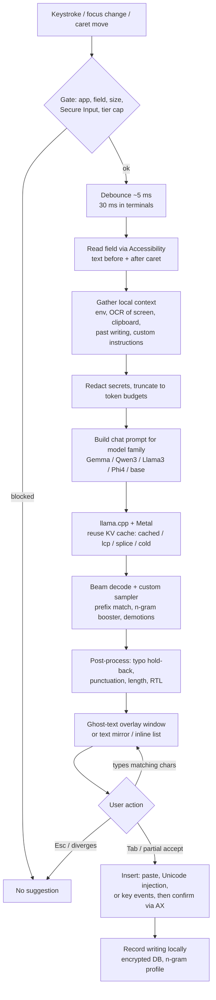

# How Cotypist Works: the local autocomplete pipeline

A reverse-engineering write-up of how Cotypist turns what you are typing, plus what is around it on screen, into inline "ghost text" completions produced by a language model running entirely on the Mac.

| | |
|---|---|
| Target | `/Applications/Cotypist.app`, version 2026.5.3 (build 85) |
| Bundle ID | `app.cotypist.Cotypist` (Accelerated Thought GmbH, team `MRLF43FW3G`) |
| Binary | arm64 Mach-O, Swift/AppKit, `LSUIElement` agent (menu-bar app, no Dock icon), not sandboxed |
| SHA-256 | `8f26fd85fc03f1b3b444fc4564c50a096aebf74031a12897e66a2af145791db5` |
| Installed model | `gemma-4-E2B-Q4_C.gguf` (2.98 GB, encrypted header) |
| Method | Static analysis of the shipped binary plus inspection of the app's on-disk files. Cotypist was not patched, injected into, or debugged. |
| Prior work | Build 81 analysis in `../rea-work/cotypist-clone/REPORT.md` |

> **About "local go".** The binary contains no Go code. It is Swift, plus a statically linked C/C++ fork of llama.cpp that runs on Metal. "Local" here means a GGUF model file on disk, run by that engine. Nothing is sent to a cloud LLM.

## Evidence labels

Every claim is tagged:

- **[O] Observed.** Seen directly in the binary (strings, call sites, immediates, disassembly) or in on-disk files.
- **[I] Inferred.** A reasoned conclusion from observed names, values and structure. Not seen executing.
- **[U] Unknown.** Not determined. Section 15 lists these unknowns and how to resolve them.

Addresses like `0x10024ea24` are the functions that decode an obfuscated string, unless they are marked as a `__cstring` address. Build 85 encrypts most of its strings (see §13). The decoded text was recovered by statically emulating those decoder functions.

Default values in this document are the fallbacks compiled into the binary. Almost every tunable is a `UserDefaults` key that a server-delivered flag set can override, and that flag set includes A/B "arms". The live values on a given Mac can therefore differ.

---

## 1. The pipeline at a glance



In one sentence: Cotypist watches the focused text field through the macOS Accessibility API. On each edit it snapshots the text around the caret and adds context such as the date, app, window title, OCR of the screen above the field, the clipboard and samples of your past writing. It wraps all of this in an instruction prompt whose *assistant turn already begins with your text*, so a small local model (Gemma 4 E2B here) simply continues it. It reuses as much KV cache as possible between keystrokes, decodes a few beams, and draws the best continuation as grey text in a transparent overlay window aligned to your caret. On accept, it types the text into the app.

---

## 2. Process architecture and permissions

| Piece | What it does | Evidence |
|---|---|---|
| Menu-bar agent | Single process, no XPC helpers for inference | [O] `LSUIElement`; llama.cpp + `__ggml_metallib` linked into the main binary |
| Accessibility (AX) | Reads the focused field and its text, and observes focus and value changes | [O] `AXObserverCreate`/`AXObserverAddNotification` at `0x1000d6940`; "Pipeline not started: accessibility permission unavailable" (`0x100b1f9c4`) |
| Input Monitoring | Listen-only keyboard tap (see §3) | [O] `CGEventTapCreate` wrapper at `0x1002343ec` |
| Screen Recording | Screenshots for OCR context and caret-line alignment | [O] "Screen capture: window not found in shareable content (screen-recording permission?)" (`0x100920bbc`) |
| Actors and queues | `CompletionManager` (UI/main), `GenerationManager`/`GenerationExecutor` (inference lane), `PromptCoordinator` (prompt build) | [O] tunable-key prefixes; [O] build 81 class names `CompletionManagerActor`, `GenerationExecutor` |

The pipeline does not start until Accessibility is granted. Screen Recording is optional; without it, the OCR context is simply missing [I].

### 2.1 Packages and libraries

The sources were the bundle layout (`Contents/Frameworks`, `Contents/Resources/*.bundle`), `otool -L`, framework `Info.plist` files, and version strings and build paths left in the binary. Only a few third-party packages are used; most features rely on Apple frameworks.

**Third-party code**

| Package | Version | How it ships | Used for | Evidence |
|---|---|---|---|---|
| **llama.cpp / ggml** (private fork) | Fork of recent upstream; references upstream PRs up to #29094 | Statically linked into the main binary, with an embedded Metal library | All model inference (§7) | [O] build path `…/Xcode/Mac/llama.cpp/ggml/src/…`, `__ggml_metallib` |
| **GRDB.swift** | 7.11.1 (`com.github.groue.GRDB`) | `Contents/Frameworks/GRDB.framework` | Local database `cotypist.db` (recorded writing, `user_inputs`) | [O] framework Info.plist |
| ↳ **SQLCipher** | 4.19.0 (SQLite with FTS5, built 2026-07-24) | Compiled into the GRDB framework | Encrypts the database at rest | [O] `sqlcipher_*` strings and version in the GRDB binary |
| **Sparkle** | 2.10.0-60-gfa8163ad (build 2064) | `Contents/Frameworks/Sparkle.framework` | App auto-updates (`SUFeedURL`) | [O] framework Info.plist |
| **sentry-cocoa** | 9.31.0 | Statically linked (Swift Package) | Crash reports, profiling, breadcrumbs | [O] build path `SourcePackages/checkouts/sentry-cocoa/…`, `sentry.cocoa` + `9.31.0` |
| ↳ **KSCrash** (as SentryCrash) | 3.2.0 | Part of sentry-cocoa | Crash capture | [O] version string next to crash-monitor strings |
| **MASShortcut** | [U] | SPM resource bundle `MASShortcut_MASShortcut.bundle` + code | Global keyboard shortcuts (accept, toggle, alternatives) | [O] bundle, `11MASShortcut` mangled symbols |
| **SwiftProtobuf** | [U] | SPM resource bundle + code | Serializing some structured messages. The decoded enum names `tierUnspecified`, `kindPaid`, `statusPastDue`, `UNRECOGNIZED` point to licensing/subscription messages [I] | [O] `13SwiftProtobuf` symbols, `google.protobuf.*` types |
| **RepliesSDK** (replies.io) | [U] | SPM resource bundle + code | In-app "Contact support" form (name, email, message, attachments, screenshot) | [O] bundle strings, `http://replies.io?ref=` |
| **zstd** | 1.5.7 | Statically linked | Compression. Which data it compresses is [U] | [O] version string next to zstd error strings |
| `CotypistMacros` | n/a | Weak-linked `@rpath` framework, not shipped in the bundle | Vendor's own Swift macros (compile time only) | [O] `otool -L` |

**No SDK for Paddle**: payments and licensing go over plain HTTPS to Paddle Billing (`Paddle-Clienttoken` header, `pri_…` price IDs) and `cotypist.app/api/…` [O].

These candidates were checked and **not** found (the names only appeared inside Sentry code or Apple APIs): Factory, swift-dependencies, Defaults, LaunchAtLogin, SwiftUI-Introspect, KeyboardShortcuts, swift-collections, swift-async-algorithms, PostHog, TelemetryDeck. Their Swift-mangled module names do not appear.

**Apple frameworks linked** [O] (`otool -L`)

| Area | Frameworks |
|---|---|
| UI | AppKit, SwiftUI, Charts (stats screen), QuartzCore, CoreText, CoreImage, AVFoundation (onboarding videos) |
| Input and Accessibility | ApplicationServices (AX, CGEvent), Carbon (hot keys), CoreGraphics |
| Screen and OCR | ScreenCaptureKit, Vision, ImageIO |
| Language | NaturalLanguage (language detection); `NSSpellChecker` from AppKit |
| ML runtime | Metal, MetalKit, Accelerate (ggml BLAS backend) |
| Data and sync | CloudKit (E2E sync), CoreData, CryptoKit, Security (Keychain, code-signature checks), Compression, libz |
| System | IOKit (hardware ID, power), SystemConfiguration, Network, ServiceManagement (launch at login), UserNotifications, MetricKit, Combine, Observation |

**Bundled resources** [O]

| Resource | Contents | Purpose |
|---|---|---|
| `Resources/Fonts/` | Inter, JetBrains Mono, Lato, Nunito, Nunito Sans, Open Sans, Roboto, Source Code Pro, Source Sans 3 | Common web fonts. Likely used so ghost text and caret alignment match web apps that use these fonts [I] |
| `Resources/emoji/` | `emoji_shortcode_list_merged_no_modifiers.bin`, `emoji_gender_variants.bin`, modifiable and non-modifiable lists | `:shortcode` emoji completion (§8) |
| `Resources/Videos/` | Accessibility-permission onboarding clips (Ventura and macOS 27, light and dark) | Onboarding |
| `Assets.car`, `tiw.nib`, `Base.lproj` | Images and UI | UI |

No model ships inside the app; models are downloaded after install (§7.2).

---

## 3. When a completion cycle starts (triggers and gating)

### 3.1 Event sources

| Source | Detail | Evidence |
|---|---|---|
| AX notifications | `AXFocusedUIElementChanged`, `AXFocusedWindowChanged`, `AXSelectedTextChanged`, `AXValueChanged`, `AXUIElementDestroyed`, `AXApplicationDeactivated`, `AXApplicationHidden`, `AXWindowMiniaturized` | [O] cstrings and small-string immediates |
| Keyboard tap | `CGEventTapCreate(kCGSessionEventTap, kCGHeadInsertEventTap, kCGEventTapOptionListenOnly, mask = 1<<kCGEventKeyDown, …)`. It is listen-only, so it can observe keys but cannot swallow them | [O] immediates `w0=1, w1=0, w2=1, w3=0x400` at `0x100234414` |
| NSEvent global monitors | Mouse clicks and scroll (cycle reasons "scroll wheel", "layout change (%@)") | [O] `addGlobalMonitorForEventsMatchingMask:` at `0x1002338b4`, `0x100351178`; reason strings at `0x1001ba350`, `0x1001b9b80` |
| Polling fallback | Re-reads the focused element every `focusedElementPollingInterval` = **1.0 s** | [O] default |
| Field session lifecycle | Reasons: "new field session", "window changed", "app deactivated", "app hidden", "dismissed with Escape", "shortcut refresh" | [O] `0x1001b7344` … `0x1001b61c8`, `0x100147c48` |

### 3.2 Speculative start from the key tap

The keyboard tap is the **primary source for speculation**: `Speculative_primarySource = "cgtap"` [O]. Cotypist can begin a generation on the key-down event *before* the target app has updated its AX value. The real AX value is then reconciled when it arrives [I].

The related tunables are:
- `Speculative_useEnabled` and `Speculative_debounceMs` (default **5**) [O]
- `Speculative_runningAheadFallbackDelayMs` and `Speculative_stagedAheadFallbackDelayMs`, the fallbacks used when the AX change never arrives [O]/[I]
- `Speculative_eagerHideEnabled`, which hides a now-stale ghost immediately [O]/[I]

Telemetry measures how much of a head start this produces: `readyLeadMs`, `realizedHeadStartMs`, `hitsAdopted`, `eagerHides` [O].

### 3.3 Debounce

| Key | Default | Meaning |
|---|---|---|
| `CompletionManager_completionUpdateDebounceMs` | **5 ms** | Wait after an edit before starting a cycle [O] |
| `CompletionManager_terminalCompletionUpdateDebounceMs` | **30 ms** | Same, for terminals [O] |
| `CompletionManager_mouseClickCompletionUpdateDelayMs` | **100 ms** | After a click moves the caret [O] |

Every generation cycle ends with an outcome. The outcome names are [O] (`0x10015ace4`…`0x10015f998`); the meanings are [I]:

| Outcome | Meaning |
|---|---|
| `cancelledInDebounce` | Superseded by another keystroke |
| `assemblyAborted` | Context changed while the prompt was being built |
| `taskCancelled` | The task was cancelled |
| `steerYielded` | Yielded to a newer "steering" request |
| `contextChanged` | The context changed |
| `noResult` | The model returned nothing |
| `stagedEmpty` | Nothing was staged |
| `staged` | A result was staged |

### 3.4 Gating: when Cotypist will not suggest

| Gate | Default / detail | Evidence |
|---|---|---|
| Field must look like a writing field | width ≥ **300 pt**, height ≥ **32 pt**, area ≥ **6400 pt²** … | [O] `automaticCompletion{Width,Height,Area}Threshold` |
| … unless it already holds enough text | ≥ **30** chars ignores the size thresholds | [O] `automaticCompletionCharacterThresholdUponWhichToIgnoreSizeThresholds` |
| Minimum typed text | **3** chars (`automaticCompletionCharacterThreshold`) | [O] value; [I] meaning |
| Excluded apps and roles | `CompletionManager_excludedApplications`; per-app "Only complete in these field types" (e.g. `AXTextArea`, `AXWebArea`), used to keep Mail's To/Subject fields out | [O] settings strings `0x10094bac0` |
| Mid-line completions | Optional per app ("Complete inside existing text"); `midLineRequireRecentTyping` | [O] |
| Code editors | Off by default per app, except AI-chat inputs; "Complete in code editors" | [O] `0x10094ab48` |
| Right-to-left text | `suppressCompletionsOnRTLText` | [O] |
| Secure Input | When another app holds Secure Event Input (password fields), keystrokes are invisible. Cotypist records "incidents" with the holder app and the affected apps | [O] `SecureInput_*`, `reportedHolderName`, `victimApps` (`0x100a03e2c`…) |
| Licensing tier | Free tier has a daily word cap ("Daily completion cap reached; completions suppressed"), and some models are tier-locked ("Model %@ not allowed for tier %@; refusing to load") | [O] `0x10014274c` |
| Integrity | "Monitoring gate closed (integrity check); not attaching to any app" | [O] |
| User toggles | Global toggle, temporary toggle, and Escape-snooze (`escapeSnoozeDurationSeconds`) | [O] `ShortcutListener_*` |

---

## 4. Reading the text field (Accessibility capture)

Cotypist builds a field snapshot holding the text before the caret, the text after it, the selection, the caret rectangle, the role and the app [I]. Build 81's type name was `TextFieldSnapshot`.

### 4.1 Standard path

The standard path uses `AXUIElement` attribute reads on the focused element, with `AXUIElementSetMessagingTimeout` to bound slow apps [O] (`0x100119da4`).

The caret rectangle comes from AX range-to-bounds queries and is validated. When it can't be trusted, the log reasons include "no cursor rect", "unsafe cursor rect", "cursor outside window" and "cursor on no screen" [O] (`0x1000c8614`, `0x1002157ac`, `0x100214fb8`, `0x100214bbc`).

### 4.2 Web browsers and Electron

- Uses the **AXTextMarker** APIs (`AXStringForTextMarkerRange` and friends) for WebKit and Chromium content, where plain string ranges are unreliable [O].
- Turns on `AXEnhancedUserInterface` / `AXManualAccessibility` for Chromium and Electron apps that don't expose their DOM to AX otherwise. Which apps get this is controlled by `CompletionManager_applicationsNeedingEnhancedUserInterface` and the per-app "Improve compatibility with this app" toggle [O].
- Reads `AXDOMIdentifier` / `AXDOMClassList` to recognize specific editors [O].

### 4.3 Editor-specific handling

| Editor | Signal | Evidence |
|---|---|---|
| Google Docs | Canvas editor; reads caret from `kix-cursor` / `kix-current-user-cursor-caret`; needs Docs' own "screen reader support" turned on (Cotypist prompts for it); caret polling (`googleDocsCaretPollLimit` 0.5 s, retry 0.03 s) | [O] `0x10005d894`, `0x1008b44f4` |
| VS Code and forks | `native-edit-context`, `monaco-mouse-cursor-text`; `vsCodeForksActivateAnywhere`; editors require the app's screen-reader mode, "which Cotypist turns on" | [O] `0x10006c384`, `0x10094ab48` |
| CodeMirror-style hidden inputs | Special handling for editors that focus a hidden `<textarea>`; can be turned off per app | [O] `0x10094b02c` |
| Terminals and TUIs | xterm.js (`xterm-screen`), native terminals; `TUISupport_*`: cursor confirmation, ambiguity retry **35 ms**, multi-line normalization, `terminalCompletionMode` = 2, question-input support | [O] |
| AI coding agents in terminals | A dedicated prompt section, "Previous output of the AI coding agent:" | [O] `0x100058c08` |
| Remote-view-hosted fields | Fields rendered by a helper process ("hosted in a remote view") get insertion events posted globally instead of to the app's PID | [O] `0x1001b7e64`, `0x1001b8448` |

Settings expose these as per-app or per-domain overrides, with built-in defaults for known apps [O].

---

## 5. Gathering local context

All of this context is gathered on the Mac. The table lists each source and whether it is enabled by default.

| Context | How it is obtained | Default | Evidence |
|---|---|---|---|
| Text before caret | AX snapshot | always | [O] |
| Text after caret | AX snapshot (mid-line mode) | when mid-line enabled | [O] |
| Date and time | System clock, **rounded to 900 s (15 min)** | on | [O] `contextDateRoundingToNearestSeconds` = 900 |
| OS languages | `Locale.preferredLanguages.joined(", ")` | on | [O] `0x1002513c4` |
| User's name | macOS account full name | on | [O] "My name: " `0x1002517b8`; [I] source |
| Active app, window title | `NSWorkspace` / AX window title | on | [O] |
| Domain | Browser URL host (per-domain settings use the same value) | on in browsers | [O] |
| Typing context | e.g. the chat channel, contact or document name | when detectable | [O] label `0x10025293c`; [U] how it is derived |
| Screen OCR | Screenshot plus Vision text recognition (see §5.1) | needs Screen Recording | [O] |
| Clipboard | `NSPasteboard`, only if recent (`pasteboardMaxAgeSeconds`) | **off** | [O] key; [I] default 0 = off |
| Past writing | Recorded texts from the local DB (see §5.2) | on if recording on | [O] |
| Custom instructions | Global plus per-app/domain text from settings | user-set | [O] |
| Spelling dialect | "Please use British English (with -ise spellings) spelling and punctuation." | option | [O] `0x1008729b0` |

Rounding the time to 15 minutes keeps the prompt's environment block byte-identical across keystrokes, so its KV cache stays reusable [I].

### 5.1 Screenshot and OCR

1. **Capture.** Cotypist uses either legacy `CGWindowListCreateImage` (`screenshot_full_window_legacy`) or ScreenCaptureKit `SCScreenshotManager captureImageWithFilter:` (`screenshot_full_window_screencapturekit`) [O] (`0x10091ff7c`, `0x100920364`, `0x1009279ac`).
2. **Scope.** Either `aboveTextField` (`screenshot_space_above`) or `fullWindow` [O]. The default `screenshotOCRScope` is **1** [O]; whether 1 means "above field" is [U].
3. **Mask own field.** `maskTextFieldInScreenshots` blanks the field being typed in, so its text isn't duplicated as "visible on screen" context [O]/[I].
4. **Downscale.** Long edge ≤ **2000 px** (`ocrMaxLongEdge`), optional grayscale [O].
5. **Recognize.** Uses Vision text recognition with `setUsesLanguageCorrection:` (`0x1009222e0`). It runs at most **4** OCR jobs at once (`screenshotOCRMaxConcurrent`) with a timeout [O]. The telemetry counters are `ocrTimeouts` and `ocrSkippedConcurrency` [O].
6. **Clean up.** These steps apply [O]:
   - drop low-value observations
   - join adjacent observations
   - re-join wrapped lines
   - filter single-word lines (`filterSingleWordLinesInScreenshot`)
7. **Exclusions.** `screenshotExcludedBundleIdentifiers` blocks capture in sensitive apps [O].

### 5.2 Your past writing as few-shot examples

Cotypist records what you type in fields where it suggests text (per app/domain, can be turned off). The recordings are stored **encrypted locally** in `cotypist.db` (GRDB, table `user_inputs`). Optionally they sync through end-to-end-encrypted iCloud (CloudKit, "Cotypist Labs") [O] (`0x1009574d0`).

At prompt time it selects samples (all values [O]):

| Key | Default |
|---|---|
| `previousUserInputFetchSize` | **20** candidates |
| `previousUserInputMinimumCharacters` | **100** |
| `previousUserInputLongestCount` / `MostRecentCount` / `AcrossAppsRecentCount` | mix of longest, most recent and cross-app samples |
| `previousUserInputTokenBudget` | **400** tokens |
| `useSameAppOnly`, `previousInputLanguagePolicy` (+ recheck) | same-app and same-language filters |
| `rankExamplesByContentLength` | ranking |
| `previousInputFolderWindowDays` | **30** days look-back |

The samples are inserted under "Recent examples of my writing:" [O].

### 5.3 Secret redaction

Before context goes into the prompt, a `SecretSanitizer` applies regex-based redaction of credential-like strings [O] (build 81 class name; build 85 has the same behaviour under an obfuscated name [I]).

---

## 6. Prompt assembly

### 6.1 The trick: pre-filled assistant turn

Cotypist uses **instruct/chat** models but does not ask them to "reply". All instructions and context go in the **user** turn. The **model** turn is opened and pre-filled with a short lead-in followed by *your own text*, so the model's most likely next tokens are the continuation of your sentence [O] (template constructors below; build 81 report agrees).

### 6.2 Templates per model family

| Family | Constructor | User-turn open | Model-turn open | Evidence |
|---|---|---|---|---|
| Gemma 3 / Gemma 4 | `0x100856c40` | `<start_of_turn>user\n` | `<end_of_turn>\n<start_of_turn>model\n` | [O] `__cstring` `0x1012adc50`, `0x1012adc70` |
| Qwen 3 | `0x1008581e8` | `<\|im_start\|>user\n/no_think\n` | `<\|im_end\|>\n<\|im_start\|>assistant\n<think>\n\n</think>\n` | [O] `0x1012ad7d0`, `0x1012ad7f0` |
| Qwen 3 (with system turn) | `0x10025c814` | `<\|im_start\|>system\n` … `<\|im_end\|>\n<\|im_start\|>user\n` | `<\|im_end\|>\n<\|im_start\|>assistant\n` | [O] `0x1012a7510`…; toggled by `ModelRepository_shouldUseSystemPromptForQwen` |
| Llama 3.x | `0x100858820` | `<\|start_header_id\|>user<\|end_header_id\|>\n\n` | `<\|eot_id\|>\n<\|start_header_id\|>assistant<\|end_header_id\|>\n\n` | [O] `0x1012adbe0`, `0x1012adc10` |
| Phi-4 mini | `0x100858af8` | `<\|user\|>` | `<\|end\|><\|assistant\|>` | [O] `0x1012ad9d0` |
| Base / pretrained models | `0x1008576c8`, `0x10085d230` | none (plain text) | "My writing:\n\n" / "The part of my writing I am currently typing:\n\n" | [O] `0x10025af54`, `0x10025b320`; [I] use with base models |

For Qwen 3, thinking is disabled twice over: `/no_think` plus an empty `<think></think>` block. There is also a separate `shouldDisableThinkingForQwen30` for the 30B MoE [O].

For Gemma 4, Cotypist reuses the Gemma 3 marker names, although Gemma 4's official template uses `<|turn>user\n … <turn|>\n<|turn>model\n`. Checked 2026-11-18 against Google's `chat_template.jinja` and `tokenizer.json`:
- Gemma 4 gives `<|turn>` id **105** and `<turn|>` id **106**. Those are the same ids Gemma 3 uses for `<start_of_turn>`/`<end_of_turn>`.
- Gemma 4's vocabulary has no `<start_of_turn>` token.

The old names therefore produce the right tokens only if Cotypist's tokenizer maps marker names to ids [I]. Tokenized as plain text, they would not.

### 6.3 The template struct (Gemma, observed layout)

The Gemma constructor fills a struct with these slots [O]:

| Offset | Content |
|---|---|
| `+0x00` | user-turn prefix |
| `+0x10` | system prompt: **nil** (Gemma has no system turn) |
| `+0x20` | model-turn prefix + `"Here is the entire text I am typing:\n"` |
| `+0x30` | model-turn prefix + `"Here is the part of the text I am currently typing:\n"` |
| `+0x40` | intro: `"I am typing the text at the end on my Mac. Additional context; some of it could be irrelevant:\n\n"` |
| `+0x50` | master instruction (310 chars, `__cstring` `0x1012a6f10`) |

The two model-turn variants mean: if the whole field fits the budget, the lead-in says "entire text"; if it was truncated, it says "part of the text" [I].

### 6.4 Section labels (verbatim)

| Label | Decoder |
|---|---|
| `I am typing the text at the end on my Mac. Additional context; some of it could be irrelevant:\n\n` | `0x10024dfc4` |
| `Today is ` … `. The current time is ` | `0x100250c04`, `0x100250fd8` |
| `Operating system languages and locales: ` | `0x1002513c4` |
| `My name: ` | `0x1002517b8` |
| `Active app: ` | `0x100251b88` |
| `Window title: ` | `0x100252068` |
| `Domain: ` | `0x100252424` |
| `Context in which I am typing (e.g. domain/contact/channel/document): ` | `0x10025293c` |
| `\n\nText visible on screen around where I am typing:\n` | `0x10024f50c` |
| `\n\nClipboard contents:\n` | `0x100250588` |
| `\n\nRecent examples of my writing:\n` | `0x10024f9fc` |
| `Previous output of the AI coding agent:` | `0x100058c08` |
| `\n\nMy text so far, up to the part I am currently typing:\n` | `0x10024ea24` |
| `\n\nWhat comes right after the part I am currently typing:\n` | `0x10024ef0c` |
| `\n\nWhat comes next:\n` | `0x10024e4b4` |

The master instruction, verbatim [O]:

> Now, please complete the following text that I am typing. Write full, grammatically correct sentences in the language and style of the existing text. Avoid using placeholders. Do not mention that your task is to provide completions, or e.g. the fact that I am typing, etc.; just try to complete the sentence.

### 6.5 Assembled prompt (illustrative)

The label strings and the template slots are observed. The **order of sections** comes from the server-tunable `PromptCoordinator_sectionOrder`, and its default was not recovered [U]. The layout below is the most plausible reading. Angle brackets mark runtime values.

```text
<start_of_turn>user
I am typing the text at the end on my Mac. Additional context; some of it could be irrelevant:

Today is <date>. The current time is <time, rounded to 15 min>
Operating system languages and locales: <en-US, de-DE, …>
My name: <full name>
Active app: <app>
Window title: <title>
Domain: <host>
Context in which I am typing (e.g. domain/contact/channel/document): <…>

Text visible on screen around where I am typing:
<cleaned OCR lines>

Clipboard contents:
<recent clipboard, if enabled>

Recent examples of my writing:
<2–N past texts, ≤ 400 tokens>

<custom instructions; optional "Please use British English …">

Now, please complete the following text that I am typing. … just try to complete the sentence.

[mid-line only]
My text so far, up to the part I am currently typing:
<earlier text>
What comes right after the part I am currently typing:
<text after caret>
<end_of_turn>
<start_of_turn>model
Here is the entire text I am typing:
<text before caret — the model continues from here>
```

### 6.6 Token budgets and truncation

| Key | Default | Evidence |
|---|---|---|
| `maxInputBeforeCursorTokens` | **350** | [O] |
| `maxInputAfterCursorTokens` | **200** | [O] |
| `maxNearAfterCursorTokens`, `midLineNearBeforeTokenBudget` | split budgets for mid-line layout | [O] key; [U] value |
| `previousUserInputTokenBudget` | **400** | [O] |
| `maxCustomInstructionsReserveTokens` | **1000** | [O] |
| `maxScreenshotTokens`, `maxPasteboardTokens`, `maxEnvironmentContextTokens` | per-section caps | [O] key; [U] value (server-fed) |
| `maxPromptLengthEstimate` | overall cap | [O] key; [U] value |
| `tokenTruncationPreferredUtilization` | **0.85** | [O] |
| `tokenBudgetRedistributionStepSize` | budget left unused by one section is redistributed to others in steps | [O] key; [I] meaning |
| `terminalEnvironmentContextTakesScreenshotBudget` | in terminals, the environment block uses the screenshot's budget | [O] |

Text before the caret is truncated from the **start**, so the end, where you are typing, is always kept [I]. Cotypist tokenizes with its own fast tokenizer (§7.3) to measure sections. A tokenization cache (`TokenizationCache_maxCacheSize` 25, `evictionCount` 5; only texts ≥ **200** chars are cached) keeps this cheap [O].

### 6.7 Mid-line layout

When the caret is inside existing text (and mid-line is enabled), the prompt switches to the "My text so far…" / "What comes right after…" layout (`midLineSplitLayout`, `midLineSplitAllCycles`) [O]. Two decoded regexes sit beside these keys [O] (`0x10023f6f0`, `0x10023fbbc`):
- `.!?\n`, the sentence-end characters
- `(^|\n)\s*-\s?$`, which detects that you are at an empty bullet

### 6.8 Scaffolding marker

`PromptCoordinator_scaffoldingMarker` is a special marker string inserted in the prompt [O]. The sampler demotes tokens that would reproduce it (`TokenSampler_shouldDemoteScaffoldingMarkerTokens`) [O]. This stops the model from echoing prompt structure into your text [I].

---

## 7. The inference engine

### 7.1 Runtime

- A **llama.cpp fork, statically linked**, with an embedded Metal library (`__ggml_metallib`) [O]. Build 81 shipped llama as separate dylibs; build 85 folds it into the main binary.
- Backends compiled in [O] (source paths in the binary):
  - **Metal**, including kernel fusion (`ggml-metal-fusion.cpp`)
  - **CPU**, with llamafile sgemm and weight repacking
  - **BLAS**, on Accelerate
- The fork keeps upstream's full architecture set [O]. That includes:
  - `gemma3`, `gemma3n`, `gemma4`
  - `qwen3`, `qwen3moe`, `qwen3next`, `qwen3vl`
  - `llama`, `llama4`, `mistral3`, `smollm3`, `lfm2`
  - the granite variants
- **Runtime observation** (2026-11-18, stderr captured with `open --stderr`, no app changes):
  - The fork prints its Metal kernel choices: `ggml-metal: mul_mm cfg … device=GGML_METAL_DEVICE_M3`, `fa-mm cfg`, `fa-vec cfg: dk=512 … kv=512` / `dk=256`, `mul_mv_ext … bf16 ne00=1536 ne11=2`.
  - So **flash attention is on**. The dimensions match Gemma 4 E2B's public config: hidden 1536, head_dim 256 / global 512, sliding window 512.
  - The kernel settings can be tuned through environment variables (`MM_VARIANT`, `NSG`, `NCPSG`, `MIN_NE01`, `Q`, `NE`, `NXPSG`, `R1PTG`, `NE11_MIN/MAX`, `KQ_NE11_MAX`); all were unset [O].

  It also keeps upstream's speculative-decoding code (MTP/NextN heads, EAGLE3, DFlash/DSpark drafts, "Gemma 4 assistant") [O]. Whether Cotypist uses any draft model is [U]. Its own `Speculative_*` keys are about starting early on keystrokes (§3.2), not draft models.
- One Gemma 4 change appears to be custom: **prefill pruning**, which can be turned off with `LLAMA_GEMMA4_PRUNE=0` [O]. It does not appear in upstream as far as checked [I].
- Metal behaviour can be tuned through `Llama_GGML_METAL_NO_RESIDENCY`, `…_RESIDENCY_KEEP_ALIVE_S`, `…_TENSOR_DISABLE` and `Llama_environmentOverrides` [O].
- It does **not** use llama.cpp's `llama_sampler_*` chain; sampling is Cotypist's own code [O] (no imports or calls).
- Startup log: "Inference engine ready (ctx %u, batch %u)". Context and batch sizes are [U]; they did not appear in the passive logs.
- Engine errors include `emptyPrompt`, `maxBatchSizeExceeded`, `llamaDecodeFailed`, `completionWidthExceedsMaximum` and `prefixWidthExceedsMaximum` [O].
- Model lifecycle states are `fresh`, `freshMed`, `freshLoad`, `reuse`, `prewarmReady`, `prewarmAdopted`, `keepAlive` and `hidden` [O].
- The model is released after `generationManagerReleaseDelay` = **60 s** of disuse [O]. A low-power/battery path can swap models (`BatteryPowerManager_modelOverrideName`) [O].

### 7.2 Models

**Installed on this Mac** [O]: `~/Library/Application Support/app.cotypist.Cotypist/Models/gemma-4-E2B-Q4_C.gguf`. It is 2,984,666,336 bytes (2.98 GB), has an encrypted header, and was the recommended model at install.

**Catalog as named in the UI** [O]. The UI offers two tiers:
- **"Light and mid-size models that run well on most Macs"**: Gemma 4 E2B & E4B, Qwen 3 1.7B & 4B, Gemma 3 1B & 4B.
- **"Full model catalog"** adds Gemma 4 26B A4B, Qwen 3 30B A3B and Qwen 3 8B: "the largest models in the catalog, for the most capable Macs".

**Every model referenced in the binary, with its source** [O]:

| Display name | Family | Source (Hugging Face repo or file) | Quant | Prompt style |
|---|---|---|---|---|
| Google Gemma 4 E2B | `gemma4` | Cotypist's own download | **`Q4_C`** (custom, encrypted) | Gemma chat |
| Google Gemma 4 E4B | `gemma4` | Cotypist's own download; a source comment mentions "E4B's UD quant" mixing q6_K/q4_K/q4_1 | `Q4_C` [I] | Gemma chat |
| Gemma 4 26B A4B (MoE) | `gemma4` | Cotypist's own download [I] | [U] | Gemma chat |
| Gemma 3 Instruct 1B / 4B | `gemma3` | `unsloth/gemma-3-1b-it-GGUF`, `unsloth/gemma-3-4b-it-GGUF` → `gemma-3-{1b,4b}-it-UD-Q4_K_XL` | Unsloth Dynamic Q4_K_XL | Gemma chat |
| Qwen 3 Instruct 0.6B / 1.7B / 4B / 8B | `qwen3` | `unsloth/Qwen3-{0.6B,1.7B,4B,8B}-GGUF` | [U] (Unsloth) | Qwen chat, `/no_think` |
| Qwen 3 Instruct 30B A3B (MoE) | `qwen3` | `unsloth/Qwen3-30B-A3B-GGUF` | [U] | Qwen chat, thinking off (`shouldDisableThinkingForQwen30`) |
| Llama 3.2 Instruct 1B / 3B | `llama3` | `unsloth/Llama-3.2-{1B,3B}-Instruct-GGUF` → `…-1B-Instruct-UD-Q5_K_XL`, `…-3B-Instruct-UD-Q4_K_XL` | UD Q5_K_XL / UD Q4_K_XL | Llama 3 chat |
| Phi 4 mini Instruct | `phi4` | `unsloth/Phi-4-mini-instruct-GGUF` | [U] | Phi chat |
| Ministral 3 3B (instruct `2512`) | `ministral3` | `Ministral-3-3B-2512` | [U] | [U] |
| **Base (pretrained) models** | | | | plain-text "My writing:" template (§6.2) |
| Qwen3 0.6B / 1.7B / 4B / 8B / 30B-A3B Base | `qwen3` | `mradermacher/Qwen3-*-Base-i1-GGUF` | imatrix (i1) [U] | base |
| Gemma 3 1B / 4B pretrained | `gemma3` | `mradermacher/gemma-3-{1b,4b}-pt-i1-GGUF` | i1 [U] | base |
| SmolLM3 3B Base | `smolLM3` | `mradermacher/SmolLM3-3B-Base-i1-GGUF` | i1 [U] | base |
| Ministral 3 3B Base `2512` | `ministral3` | `mradermacher/Ministral-3-3B-Base-2512-GGUF` | [U] | base |
| Gemma 3 270M | `gemma3` | `ggml-org/gemma-3-270m-GGUF` | [U] | [U]. Possibly a tiny test or helper model [I] |

Notes:
- The Hugging Face entries are downloaded from `https://huggingface.co/` [O]. The repo is also recorded in the GGUF key `general.source.huggingface.repository`.
- The base models and several extras are probably hidden or experimental (`ModelRepository_listExtraModels`) [I]. The main UI only lists the Gemma and Qwen instruct models above [O].
- Models are restricted by tier ("Model %@ not allowed for tier %@; refusing to load") [O].
- A different model can be forced on battery (`BatteryPowerManager_modelOverrideName`) [O].
- Optional **LoRA adapters** can be layered on top (`ModelRepository_selectedAdapter`) [O]. None are installed here.
- Gemma model downloads show Google's Gemma Terms of Use [O].
- Model families are `qwen3`, `gemma3`, `gemma4`, `ministral3`, `smolLM3`, `phi4` and `llama3` [O].
- First-party downloads use a custom **`Q4_C`** quantization with an **encrypted GGUF header**. Integrity is validated before loading ("Model integrity validation rejected") [O]. File-size checks also exist ("Model File Size Valid") [O].
- A recommended model is picked from the chip and RAM tier (`chip`, `ramTier` in the telemetry config) [O]/[I].

### 7.3 Fast tokenizer

Cotypist keeps its own tokenizer caches per model/vocabulary under `~/Library/Caches/app.cotypist.Cotypist/tokenizer/` [O]:
- `fte-…bin` with magic `FTE1`
- `vtc-…bin` with magic `VTC1` and vocab 262144 (the Gemma 4 vocabulary)

The `Llama_fastTokenize` (default on) and `Llama_fastSampler` keys toggle the fast paths [O]. The likely purpose is tokenizing hundreds of context tokens per keystroke without calling into llama's slower generic tokenizer [I].

### 7.4 KV-cache reuse: the core latency trick

Each keystroke changes only the end of a long prompt. Cotypist classifies every job's cache reuse [O]:

| Reuse kind | Meaning [I] |
|---|---|
| `cached` | Identical prompt, so the result or logits come straight from cache |
| `lcp` | Longest-common-prefix reuse: remove the divergent KV tail and decode only new tokens |
| `splice` | **KV splicing**: an earlier section changed (e.g. OCR text), but a later chunk is unchanged. The unchanged chunk's KV is kept and position-shifted instead of recomputed (`kvSplicingEnabled`, `kvSplicingMinExtraTokens`) |
| `cold` | Nothing reusable; full prefill |

Other mechanisms [O] (names; meanings [I]):

| Mechanism | What it does |
|---|---|
| Parked sequences (`parkedSequences{Enabled,Count,MaxDivergence,MaxGenerationAge}`, default on) | Keeps KV for recent alternative prompt states in spare llama sequence slots. Undo and backspace can then reseed from a parked state (`jobsSeededFromParked`, `sumTokensParkedSeedSaved`) |
| User-text relocation (`userTextRelocation`, default on) | Moves the user-text KV block to new positions when the context before it changes length (`sumRelocatedTokens`) |
| Diff tiling (`diffTilingEnabled`) | Finer-grained diffing of changed regions. [U] exact algorithm |
| Extended prefill / prewarm (`extendedPrefillEnabled`, `jobsPrewarm`, `prewarmDecodeMs`) | Prefills the prompt when a field gains focus, before the first keystroke (`activationToFirstKeystrokeMs`, `kvPrefillMs`) |
| Logit cache (`LogitCache_maxPinnedEntries`, `maxStaleEntries`) | Keeps next-token distributions for recent positions |
| `completionCache.dat` | Completion results persisted on disk |

Telemetry tracks exactly these savings [O]:
- `sumTokensDecoded` vs `sumTokensLcpWouldDecode` vs `sumTokensKVReused`
- `promptLoadMs`, `beamDecodeMs`, `laneWaitMs`
- `keyToAxMs`, `keyToDisplayMs`, `axToDisplayMs`

### 7.5 Decoding: beams, prefix search and a custom sampler

- **Several beams per request**: "First completion shown for %@ (prompt %ld tok, %ld beams)" (`0x100146184`), `beamDecodeMs` [O]. The beams are decoded as parallel sequences in one batch [I]; build 81 tuple labels `(altIdx, batchIndex, cacheKey)` support this.
- **Ranking.** Candidates are scored by average log-probability with a length penalty (`TokenSequence_lengthPenaltyScalingFactor`, `…Exponent`) [O]; build 81 has the labels `averageLogprob`, `confidence`. Longer completions are not unfairly penalized [I].
- **Typed-prefix search (token healing).** When you are mid-word, the partial word may not end on a token boundary. Cotypist backs up and constrains the first generated tokens to ones consistent with what you already typed [I]. Related keys [O]: `typedPrefix`, `GenerationManager_maxPrefixLength` = **20**, `prefixExpansionLimit`, `expansionLimit`, `transitionExpansionLimit`, `TokenSampler_includeSpaceOnlyTokenInPrefixSearch`, and the strings "(space-committed search)" and "infer-from-ghost".
- **Demotions** (pushed down, not banned) [O]:
  - invalid-UTF-8 tokens
  - "problematic invisible characters"
  - scaffolding-marker tokens
- **Personalization booster.** An n-gram model of your writing biases token scores (§11.2) [O]/[I].
- **Optional LoRA adapters** ("Select a LoRA adapter to customize the model behavior.", `ModelRepository_selectedAdapter`) [O].
- **Threads.** `GenerationManager_threadCount` sets CPU threads; Metal does most of the work [O]/[I].

### 7.6 "Infer from ghost"

If you type exactly the characters the ghost already shows, Cotypist advances the existing suggestion and does not run the model again [I] (string "infer-from-ghost" at `0x10018d030`; build 81 has the same behaviour). Combined with the logit cache, most "typing along with the ghost" keystrokes cost no inference.

---

## 8. Post-processing

| Step | Detail | Evidence |
|---|---|---|
| Length cap | `maxCompletionLength` (enum-like default, value [U]); results trimmed at sentence/line boundaries | [O] key |
| Typo hold-back and autocorrect | If the current word looks misspelled, completions can be suppressed (`suppressCompletionsOnSuspectedTypo`). Instead, a correction is offered when the model prefers the fixed word by ≥ `minLogprobDelta`. `requireContextFreeMisspelling` asks `NSSpellChecker` too; `runOnSentenceEnd` | [O] `AutocorrectSupport_*`, `offeredLogprobDeltaCentinats` |
| Trailing punctuation and spaces | `trailingPunctuationMode` (default 1); punctuation sets `.,;:!?"'()[]{}«»-/~–—…“”‘’` and `.!?…,;:` | [O] `0x10025efbc`, `0x100262cc0` |
| Smart quotes | Converted per app; skipped if the last **50** typed chars contain straight quotes | [O] `skipSmartQuotesIfLastNUserInputCharactersContainRegularQuotes` |
| British English | Optional substitution mode (`BritishEnglishSubstitutionMode`) plus the prompt line | [O] |
| Word alternatives and thesaurus | Other candidates for the next word, revealed after a **2 s** pause or by shortcut | [O] `wordAlternativesPauseDelay` = 2.0 |
| Emoji | `:`-triggered emoji shortcode completion (trie), separate from the LLM | [O] `EmojiCompletion_*` |
| Language list | English, German, French, Spanish, Italian, Portuguese, Dutch (spelling and language checks) | [O] `0x10025fc84`…; [I] purpose |

---

## 9. Showing the suggestion

| Surface | When | Evidence |
|---|---|---|
| **Ghost-text overlay** | Default. A borderless, click-through window above the app at `overlayWindowLevel`. Text is drawn in a translucent shade of the field's own text colour (or neutral grey per app), at the field's font size, starting at the caret rect | [O] settings strings, `CompletionOverlayManager_overlayWindowLevel` |
| **Text mirror** | Apps whose caret geometry is unreliable. Cotypist redraws the line itself in an overlay ("Use a text mirror overlay for cursor positioning") | [O] `0x100948e8c` |
| **Inline suggestions list (pill)** | Right-to-left or mixed-direction text, or when the ghost has no room; Liquid Glass style on macOS 27 | [O] `InlineSuggestionsList_*` |
| Per-app fixes | Font-size factor and vertical offset overrides | [O] `CursorAttributes_*` |

**Caret-line alignment by image matching** [O] (`CursorLineAlignment_*`, debug files `_01_screenshot.png` … `_08_side_by_side.png`, "Font Size Search Debug Info"). When AX doesn't report the font size accurately, Cotypist works it out from the screen [I]:

1. Screenshot a small rectangle around the caret line.
2. Render the line's text at candidate font sizes.
3. Compare column profiles. Fit thresholds are `minRSquared`, `minConfidence` and polarity margin/contrast (for dark vs light text).
4. Pick the best size and vertical offset, then cache the result per field (`cacheMaxEntries`, `cacheMaxAge`).

---

## 10. Accepting and inserting text

### 10.1 Accept actions

| Action | Detail | Evidence |
|---|---|---|
| Accept full | `acceptFullCompletionShortcut` (+ alternate). Default is the **key above Tab** (ANSI keyCode 50, `` ` ``), when the keyboard layout has one | [O] stored shortcut + onboarding text "full-completion shortcut already bound to the key above Tab" |
| Accept next word | `acceptPartialCompletionShortcut` (+ alternate). Default is **Tab** (keyCode 48; the per-app "Disable Tab key" setting turns it off). Options include `stopAtCaseChange`, `cjkPerCharacter`, `includeTrailingPunctuation` (default **on**) and `includeTrailingSpaceIfAvailable` | [O] `acceptNextWordOnly_*` |
| Dismiss / snooze | Escape (`escapeBehavior`, `escapeSnoozeDurationSeconds`, `captureEscapeOnlyWhileSuggestionShown`) | [O] |
| Others | Word alternatives, thesaurus, global and temporary toggles, force-enable | [O] `ShortcutListener_*` |

Shortcuts are Carbon hot keys (`RegisterEventHotKey`, MASShortcut-style) [O] (`0x100b29260`). The keyboard tap is listen-only, so Tab cannot be intercepted there. Instead, the hot key is registered only **while a suggestion is visible** and released otherwise, so Tab keeps its normal meaning [I]. Evidence for this: `captureEscapeOnlyWhileSuggestionShown`, `shouldUnregisterCompletionShortcutsForMostFailures`, and the Option-Tab fallback `shouldRegisterOptionTabShortcutAsFallback`.

### 10.2 Insertion methods

| Method | Detail |
|---|---|
| **Unicode string injection** | `CGEventKeyboardSetUnicodeString` + `CGEventPost` / `CGEventPostToPid` in chunks. Default chunk is **20** chars; per-app overrides use 0 = paste, 1 = char-by-char, >1 = chunk, -1 = first word only [O] `0x1002721a4`, `0x100952874` |
| **Paste** | Puts the text on the pasteboard, sends ⌘V, then restores the previous clipboard (`pasteboardPasteDelay`, `pasteboardRestoreDelay`) [O] |
| **Workarounds** | Per-app [O]: non-breaking space for leading spaces, real space key event, "Paste and Match Style", Backspace right after paste |
| **Event target** | Posted to the app's PID normally; posted globally for remote-view-hosted fields (`shouldPostPasteEventsGlobally_override`, `TypingEvents_sendEventsGloballyForApps`) [O] |
| **Confirmation** | After inserting, Cotypist checks through AX that the text arrived within `insertionConfirmationTTL` = **1.0 s**. Otherwise it logs "Insertion never reached %@ (%ld insertions; AX trusted %ld, post events %ld)" [O] `0x1001a3650` |
| **Fade** | Optional fade of the accepted ghost (`fadeAcceptedCompletionEnabled`, default off; fallback 0.3 s) [O] |

---

## 11. The local learning loop

### 11.1 Recorded writing

`TrainingDataCollector_*` stores snapshots of the text you type in eligible fields [O], with these defaults:

| Key | Default |
|---|---|
| `minimumStorageCharacterLength` | **33** chars |
| `maxRecentSnapshots` | **100** in memory |
| `snapshotRetentionWindow` | **3600 s** |

It can also keep a screenshot/OCR form of the context (`screenshotStorageFormat`, `CloudSync_includeOCRText`) [O]. The data goes into the encrypted `cotypist.db` and feeds the few-shot examples in §5.2. The "Typing History" settings pane lists counts per app and domain and offers delete actions; deletes propagate to iCloud when sync is on [O].

### 11.2 Personalization n-gram booster

Two files are involved:
- `~/Library/Caches/app.cotypist.Cotypist/extras/gemma4-v262144/profile.bin` (magic `FEBI`, 3.17 MB) exists on this Mac [O].
- `ngram-booster.bin` is named in the binary [O], but the folder meant for it (`~/Library/Application Support/…/Models/extras/gemma4-v262144/`) is **empty** here. It may be an optional download or only created when the feature is on [I].

Both are keyed per vocabulary (`gemma4-v262144`), so they are rebuilt for each model family [I]. The settings are [O]:
- `InputBuffer_personalizationStrengthV2`
- `smoothingFactor`
- `minSamples`
- `selectivity`
- `lengthBoostFactor`
- `boosterAlpha`

Mechanism [I]: an n-gram profile of your recorded writing adds a bonus to tokens that continue your habitual phrases. It is blended with strength α and smoothed so that rare n-grams don't dominate. It runs alongside the LLM, inside Cotypist's own sampler.

### 11.3 Stats

`completionStats.json` and the `Completion.AcceptanceDaily` counters hold counts only [O]. Field names include `completionCountRounded`, `wordCountTotalLog` and `averageWordsPerActiveDayRounded`.

---

## 12. What leaves the Mac

| Channel | Content | Evidence |
|---|---|---|
| Inference | **None.** The model runs locally | [O] no remote-LLM endpoints; local llama.cpp |
| Recorded writing | Only if E2E iCloud sync is turned on (CloudKit `UserInput` records + `SyncKey`) | [O] `0x1009574d0`, `0x100ae0230` |
| Analytics | Event counters and rounded/log-bucketed stats, model name, chip/RAM tier, flags. No text fields were observed in the schema | [O] `CotypistAnalyticsAdapter_analyticsURL`, stat field names; [I] "no text" |
| Crash reports | Sentry | [O] |
| Server flags | Downloaded tunables and A/B arms (`serverFlags`, `arms`, `flagsRev`) | [O] |
| Licensing / updates | Paddle checkout and token validation, `cotypist.app/api/sale_state`, Sparkle `SUFeedURL` | [O] |
| Diagnostics | Opt-in 10-minute diagnostic capture after restart; compatibility feedback; module inventory upload (`ModuleInventory_uploadEndpoint`) | [O] `0x1008f0524`, `0x1008fabf0`; [U] module inventory payload |

## 13. Hardening in build 85

This section is for context only; nothing here was bypassed.

| Measure | Detail |
|---|---|
| Obfuscated Swift metadata | Type names are obfuscated; field names and tuple labels are stripped |
| Encrypted string literals | About 2,091 strings are decoded at runtime through a chained XOR/LCG/swap routine; about 1,700 were recovered statically for this analysis |
| Self-checks | Code signature checked against a team-ID requirement (`SecStaticCodeCheckValidity`), `DYLD_INSERT_LIBRARIES`/Frida/`get-task-allow` checks, and an integrity gate that stops monitoring |
| Encrypted at rest | Encrypted model header (`Q4_C`) with integrity validation; encrypted GRDB database |

---

## 14. Changes from build 81

| Area | Build 81 | Build 85 |
|---|---|---|
| Symbols | Readable Swift class names | Obfuscated names, stripped labels, encrypted strings |
| llama.cpp | Separate dylibs | Statically linked fork with embedded Metal lib |
| Models | Qwen3-centric | Gemma 4 (E2B default here), custom `Q4_C` + encrypted header, larger MoE options |
| Tokenizer | llama tokenizer | Own fast tokenizer with on-disk `FTE1`/`VTC1` caches |
| KV reuse | Prefix reuse | Plus splicing, parked sequences, relocation, diff tiling, prewarm |
| Context | Screen OCR, clipboard | Plus terminal/TUI and AI-agent output, typing-context line, mid-line split layout |
| Personalization | Few-shot past writing | Plus n-gram booster profile and LoRA adapters |

The build 81 column is from the earlier report. A few rows (e.g. "Qwen3-centric") reflect what that report emphasized, not an exhaustive diff.

---

## 15. Unknowns and how to close them

| Unknown | Why it matters | How to resolve |
|---|---|---|
| Default `sectionOrder` and the placement of custom instructions | Exact prompt layout | Decompile the 29 KB assembler at `0x10014af2c` with Ghidra/IDA, or decode the `sectionOrder` default blob |
| Context window and batch size | Memory and latency sizing | Still open. Tested 2026-11-18: the `Logging_*` preference keys produce no output in build 85, and llama.cpp's messages go through a muted callback. Runtime stderr did confirm flash attention and the Gemma 4 E2B shape (see §7.1) |
| `maxScreenshotTokens`, `maxPasteboardTokens`, `maxEnvironmentContextTokens`, `maxPromptLengthEstimate` | Budget split | These getters use helper paths the default extractor didn't follow; trace `0x10025699c` and its peers |
| Beam count, sampling temperature, top-k | Output diversity | Decompile the sampler (no `llama_sampler_*`; follow `llama_get_logits_ith` callers). Runtime hint: one decode call processed 2 rows (`ne11=2`), consistent with 2 parallel sequences [I] |
| Exact n-gram booster formula and file formats | Personalization behaviour | Static decompile of `InputBuffer` code. The `FEBI`/booster files are user data; parse them only with the user's consent |
| Server-flag values actually in effect | Real defaults differ from the compiled ones | Read `ServerFlags` from the app's preferences; don't spoof the server |
| How "typing context" is derived | Channel/contact detection | Trace callers of decoder `0x10025293c` |
| About 380 strings not decoded | Mostly licensing and anti-tamper, some unknown | Emulate from the key-load site with the remaining helper calls modelled |

---

## Appendix A: compiled-in defaults (selected)

| Key | Default |
|---|---|
| `CompletionManager_completionUpdateDebounceMs` | 5 ms |
| `CompletionManager_terminalCompletionUpdateDebounceMs` | 30 ms |
| `CompletionManager_mouseClickCompletionUpdateDelayMs` | 100 ms |
| `CompletionManager_focusedElementPollingInterval` | 1.0 s |
| `CompletionManager_automaticCompletionCharacterThreshold` | 3 |
| `…CharacterThresholdUponWhichToIgnoreSizeThresholds` | 30 |
| `…TextFieldWidthThreshold` / `HeightThreshold` / `AreaThreshold` | 300 / 32 / 6400 |
| `CompletionManager_insertionConfirmationTTL` | 1.0 s |
| `CompletionManager_acceptDisplayFallbackDelay` | 0.3 s |
| `CompletionManager_wordAlternativesPauseDelay` | 2.0 s |
| `CompletionManager_generationManagerReleaseDelay` | 60 s |
| `CompletionManager_googleDocsCaretPollLimit` / `…RetryDelay` | 0.5 s / 0.03 s |
| `CompletionManager_skipSmartQuotesIfLastNUserInputCharactersContainRegularQuotes` | 50 |
| `CompletionManager_detectRemoteViewHostedFields` | true |
| `CompletionManager_fadeAcceptedCompletionEnabled` | false |
| `CompletionManager_acceptNextWordOnly_includeTrailingPunctuation` | true |
| `CompletionInserter_defaultStringInjectionChunkSize` | 20 |
| `GenerationManager_maxPrefixLength` | 20 |
| `GenerationManager_parkedSequencesEnabled` | true |
| `GenerationManager_userTextRelocation` | true |
| `PromptCoordinator_maxInputBeforeCursorTokens` | 350 |
| `PromptCoordinator_maxInputAfterCursorTokens` | 200 |
| `PromptCoordinator_maxCustomInstructionsReserveTokens` | 1000 |
| `PromptCoordinator_previousUserInputFetchSize` | 20 |
| `PromptCoordinator_previousUserInputMinimumCharacters` | 100 |
| `PromptCoordinator_previousUserInputTokenBudget` | 400 |
| `PromptCoordinator_previousInputFolderWindowDays` | 30 |
| `PromptCoordinator_tokenTruncationPreferredUtilization` | 0.85 |
| `PromptCoordinator_contextDateRoundingToNearestSeconds` | 900 |
| `Speculative_debounceMs` | 5 |
| `TextFieldContextCapture_ocrMaxLongEdge` | 2000 px |
| `TextFieldContextCapture_screenshotOCRMaxConcurrent` | 4 |
| `TokenizationCache_maxCacheSize` / `evictionCount` | 25 / 5 |
| `Tokenizer_minimumTextLengthForCaching` | 200 |
| `TrainingDataCollector_maxRecentSnapshots` | 100 |
| `TrainingDataCollector_minimumStorageCharacterLength` | 33 |
| `TrainingDataCollector_snapshotRetentionWindow` | 3600 s |
| `TUISupport_cursorAmbiguityRetryDelayMs` | 35 ms |

**How these were read.** Each tunable has a getter that calls the key's string decoder, reads `UserDefaults`, and on `nil` falls back to an immediate loaded right after the call (e.g. `mov x8, #0x4014000000000000` = 5.0 at `0x100114ca8`). Values are reported only where the immediate was unambiguous. Enum-like defaults are given as raw integers or omitted.

## Appendix B: method

1. **Inventory.** Parsed the Mach-O sections and the Swift `__swift5_*` metadata; collected plain C strings and imports.
2. **Linear sweep.** Swept ARM64 code using `LC_FUNCTION_STARTS`. For each function it recorded C-string references, Swift small-string immediates, imported-stub calls, Objective-C selector stubs and local branch targets.
3. **String decryption.** Identified about 2,091 decoder functions and emulated each one statically at instruction level, modelling only the Swift runtime helpers they call. This recovered about 1,709 strings, then a few hundred more from inlined sites.
4. **Defaults.** Read the fallback immediates in each tunable getter.
5. **Template structs.** Disassembled the per-family prompt constructors to recover slot layout.
6. **On-disk files.** Read the app's own cache and support directories (file magics, sizes). Encrypted model and database contents were not decrypted.

Cotypist was not run under a debugger, instrumented, or modified. The analysis scripts were throwaway tools in a temporary scratch directory and are not part of this documentation.
